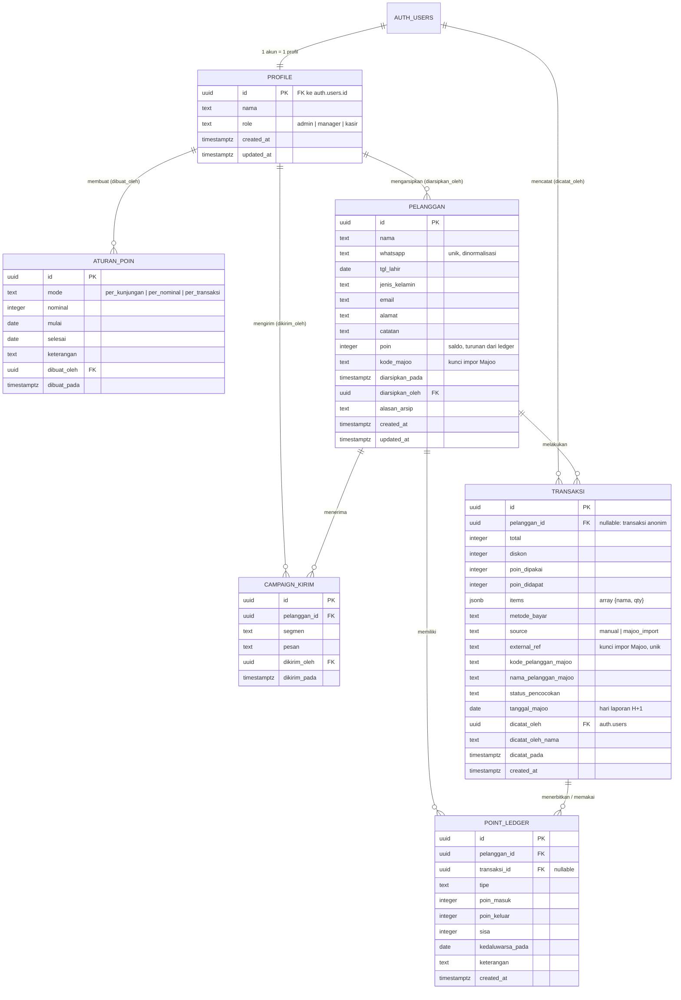

# ERD Sistem Kataloji CRM

Sumber: skema nyata dari database (PostgREST OpenAPI) dan berkas SQL di `supabase/`. Tanggal pemeriksaan: 12 Okt 2026.

## Diagram relasi

## Keterangan per entitas

| Tabel | Fungsi | Catatan kunci |
|---|---|---|
| `profile` | Peran staf (admin, manajer, kasir) | Satu baris per akun auth. Peran dibatasi CHECK. |
| `pelanggan` | Data pelanggan | Nomor WA unik. `poin` adalah saldo turunan dari `point_ledger`. Arsip memakai `diarsipkan_pada`, bukan hapus. |
| `transaksi` | Setiap penjualan, manual maupun impor Majoo | `external_ref` unik untuk impor. `pelanggan_id` boleh kosong (anonim). `tanggal_majoo` dipakai untuk hari laporan. |
| `point_ledger` | Jejak mutasi poin | Setiap masuk dan keluar tercatat. Tidak diubah diam-diam (prinsip audit). |
| `aturan_poin` | Aturan perolehan poin per periode | Mode `per_kunjungan` aktif. Kolom `aktif` dan `berlaku_dari` **tidak ada**. |
| `campaign_kirim` | Riwayat pesan campaign | Mencatat siapa mengirim ke siapa dan kapan. |
| `rekap_pencatat_transaksi` | **View**, bukan tabel | Ringkasan jumlah transaksi dan omzet per staf. Hanya dibaca. |

## Catatan integritas

- `transaksi.dicatat_oleh` mengacu ke `auth.users`, bukan `profile`. Jika profil dihapus, jejak pencatat tetap ada.
- `point_ledger` adalah sumber kebenaran poin. `pelanggan.poin` adalah hasil turunan dan harus selalu sama dengan jumlah ledger.
- Jalur impor Majoo tidak menimpa baris yang sudah ada (lihat `3de368d`). Tautan `pelanggan_id` yang belum terhubung dikerjakan lewat halaman Pencocokan.

## Yang belum terverifikasi

- **Tipe `text` vs enum** untuk `mode` dan `role`: CHECK constraint ada di SQL, tetapi tidak saya cek satu per satu untuk setiap kolom.
- **Trigger** (`hitung_poin_transaksi`, `trg_transaksi_pencocokan`) tidak digambarkan di ERD. Ini logika, bukan struktur.
- Tabel `campaign` dan `arsip_pelanggan` (dari berkas SQL `campaign.sql` dan `arsip-pelanggan.sql`) **tidak ada di DB** (diperiksa langsung: HTTP 404). Berkas SQL-nya belum dijalankan di DB ini. Fitur campaign dan arsip belum bisa berfungsi di DB sekarang, dan ini harus dijalankan dulu sebelum diuji.
